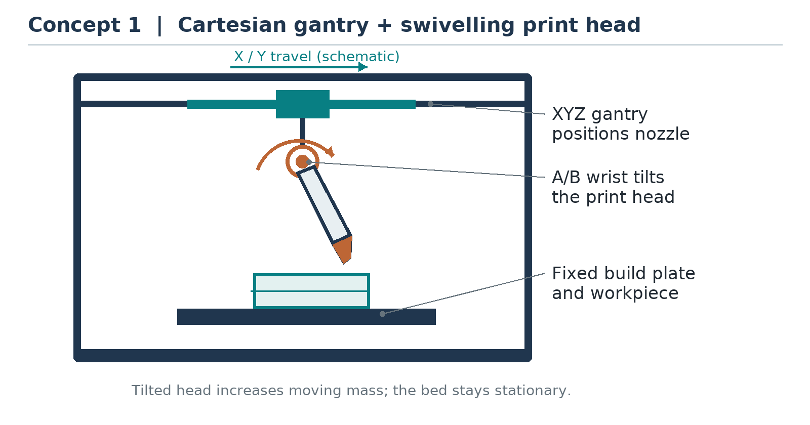
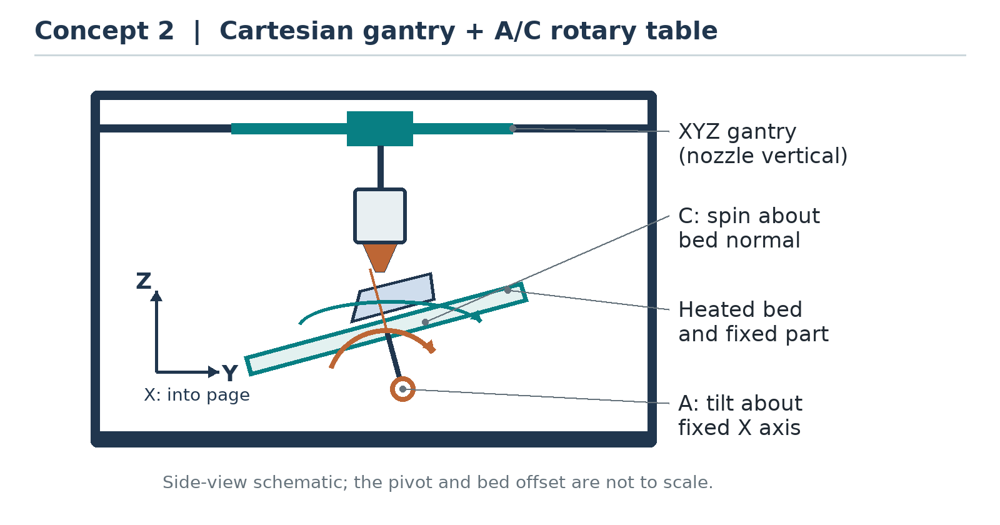
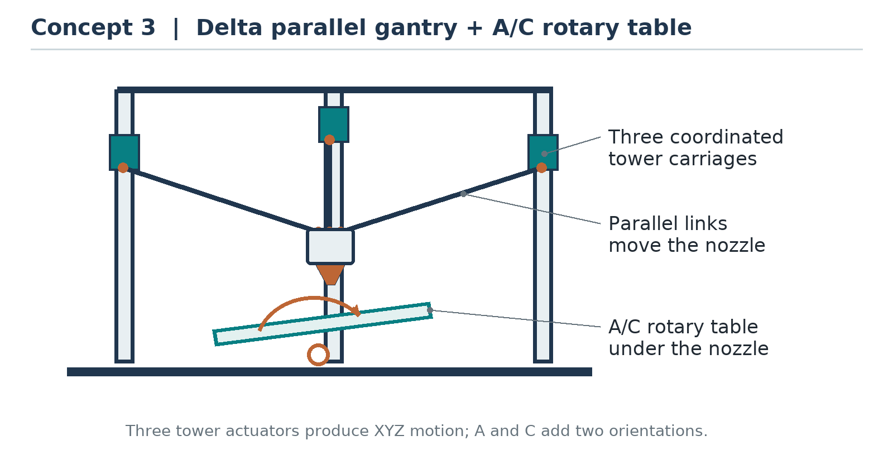
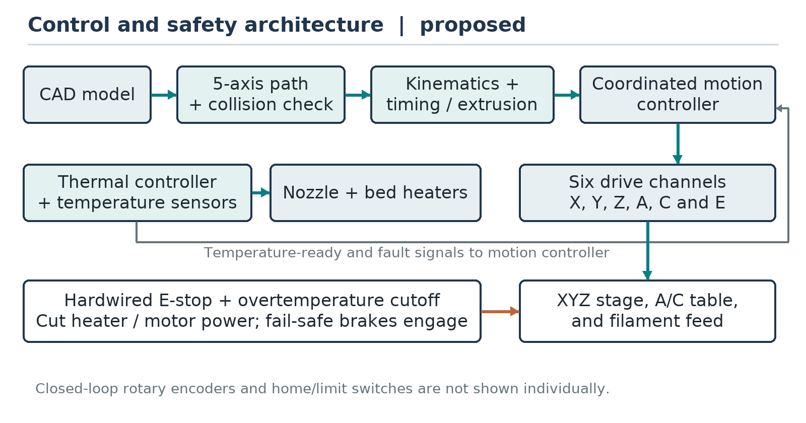

# Abstract

Conventional three-axis material-extrusion printers build mainly in a fixed orientation. Overhanging features may therefore require temporary supports, while curved surfaces can show a stair-step pattern. This thesis proposal presents the design and development of a five-degree-of-freedom (5-DOF) fused-filament-fabrication printer for laboratory-scale polymer parts. The proposed machine combines three Cartesian translations of a vertically oriented nozzle with a two-axis tilting and rotating build table. Three machine concepts are compared, and the Cartesian gantry with an A/C rotary table is selected using a weighted decision matrix. The study develops a preliminary mechanical architecture, coordinate transformation, actuator-sizing examples, a coordinated motion and temperature-control strategy, and a staged verification plan. A 150 mm × 150 mm heated bed, a 0.4 mm nozzle, and polylactic acid filament are proposed as the initial test configuration. Validation will compare a conventional planar path with a feasible five-axis path for the same overhanging test part, alongside independent positioning, temperature and safety checks. Reduced support use and improved access are research objectives, not guaranteed outcomes; nozzle clearance, bed adhesion, rotary limits, software capability and material flow remain important constraints. The numerical calculations are design illustrations, and no prototype measurements or experimental results are claimed.

**Keywords:** five-degree-of-freedom printer; fused filament fabrication; tilting rotary table; nonplanar slicing; mechatronics; support reduction.

# 1 Introduction

## 1.1 Background of the Study

Additive manufacturing produces parts from digital descriptions through the successive addition of material. Fused filament fabrication (FFF) is a material-extrusion process in which a motor feeds thermoplastic filament into a heated nozzle, and the deposited material bonds to the previously placed material [1]. Its relatively accessible equipment and feedstock make it useful for prototypes, teaching aids and small functional parts.

A conventional Cartesian printer positions its nozzle along the $X$, $Y$ and $Z$ directions while the deposition axis remains essentially fixed relative to the build plate. Most conventional slicers create flat, horizontal layers. On curved or shallow-sloping surfaces, these discrete layers can create visible steps; overhanging features can require support that consumes material and must later be removed. Strength and finish also depend on the material, deposition orientation, thermal history and other process parameters [6], [7], [9].

In five-axis printing, two additional rotations change the orientation between the nozzle and the part. They can enable selected inclined or curved paths and reduce support for some geometries, but introduce coupled motion, collision, calibration, extrusion and software problems [3]–[5], [8]. This project treats the printer as an integrated mechanical, electronic, thermal and control system rather than as a conventional printer with two motors added.

## 1.2 Problem Statement

A three-axis printer with a fixed build orientation has limited access to features that extend beyond material already deposited. Support structures can increase material consumption and post-processing, and planar layers may not be well aligned with a desired surface. A five-axis machine may address some of these limitations, but a successful design must also coordinate rotary and linear movements, compensate for the position of the rotary pivot, avoid collisions with the part and fixtures, manage cables on the moving table, and maintain a stable extrusion rate. Five-axis software and additional components can also make the system difficult to assemble and validate in an educational laboratory.

The problem addressed by this study is therefore how to design and evaluate an educational 5-DOF FFF printer that combines attainable mechanical construction with a defined kinematic model, safe coordinated motion and a reproducible comparison with ordinary planar printing. The project does not assume that every overhang can be printed without support or that an untested machine is more accurate than an existing printer.

## 1.3 Objectives of the Study

### 1.3.1 General Objective

To design, model, develop and experimentally evaluate a laboratory-scale five-degree-of-freedom 3D printer capable of coordinated material extrusion on selected inclined and curved paths.

### 1.3.2 Specific Objectives

- To identify the functional, workspace, safety and performance requirements of a 5-DOF FFF printer.
- To develop three five-axis concepts and select one using a transparent evaluation matrix.
- To size the principal actuators and structure using stated load assumptions, and develop a detailed 3D CAD model.
- To analyse the frame and rotary supports by hand calculations and finite element analysis (FEA).
- To derive and verify the kinematic transformations between a rotating part and the Cartesian nozzle.
- To develop a coordinated motion, filament-feed and temperature-control architecture with appropriate safety interlocks.
- To fabricate and calibrate a prototype, then test positioning, temperature control and representative print quality.
- To compare support material and print completion for a selected overhanging part made with three-axis and five-axis paths.

## 1.4 Scope of the Study

The intended prototype uses one nozzle, 1.75 mm diameter polylactic acid (PLA) filament, three linear positioning axes, and a build table with one bounded tilt axis and one bounded rotation axis. The work covers concept selection, CAD, preliminary analysis, motion planning, a laboratory prototype and bench testing. A conventional planar print at zero tilt is the comparison baseline; indexed 3+2 printing and a small continuous five-axis path will be investigated in stages.

The study does not cover metal or composite printing, multiple materials, industrial certification, arbitrary part geometries, commercial production, or a universal automatic five-axis slicer. The specified dimensions and performance limits are design targets, not demonstrated capabilities. A part must also satisfy the mass, clearance, adhesion, motion and temperature limits in every planned orientation.

## 1.5 Significance of the Study

The study provides a structured design example for students integrating mechanics, electronics, control, CAD and manufacturing. If experimentally verified, the proposed platform could allow local investigation of nonplanar paths and support reduction on suitable small parts. The documented coordinate convention, preliminary calculations and test procedure are intended to make the design easier to reproduce and improve. The degree of any benefit must be established by the proposed measurements rather than assumed from the additional axes.

## 1.6 Research Questions

1. Can an A/C table and a Cartesian nozzle be coordinated to maintain a specified tool position and orientation within the proposed workspace?
2. Can a selected overhanging PLA test piece be completed with less support material than its planar baseline, without unacceptable dimensional error or a lower completion rate?
3. Which practical limitations in calibration, collision clearance, bed adhesion and thermal behaviour restrict the useful orientations?

# 2 Literature Review

**Terminology and process.** ISO/ASTM 52900:2021 defines additive-manufacturing terminology and identifies material extrusion as a process category [1]. In this proposal, FFF denotes filament-fed material extrusion; the five degrees of freedom refer to the relative tool pose, not to the filament-feed actuator.

**Machine and part design.** Wulle et al. discuss the relationship between workpiece and machine design for multi-axis FFF [2]. Their work illustrates that the part, printhead and machine arrangement must be considered together. Consequently, the proposed design treats the printed part, fixture and printhead as collision bodies rather than relying on axis travel alone.

**Five-axis machine and process characteristics.** Shen et al. describe a five-axis FFF machine and printing methods, and examine extrusion behaviour associated with different printing modes [3]. This supports including both motion and flow control in the proposed system. Their published results do not establish the performance of the new concept described here.

**Curved-layer planning.** Isa and Lazoglu propose five-axis planning based on transition layers for freeform parts [4]. Their work shows the importance of connecting layer geometry with machine orientation. A practical limitation for the present project is that feasible paths must also respect its comparatively small tilt range and finite rotary travel.

**Accessible implementation.** Hong et al. present Open5x, an accessible five-axis printer and conformal-slicing workflow [5]. The work demonstrates a useful hardware-and-software direction for educational systems, but its implementation cannot be assumed to operate an arbitrary machine without adapting geometry, firmware, calibration and safety checks.

**Nonplanar slicing and clearance.** Ahlers et al. combine planar and nonplanar layers and consider printhead collisions on a three-axis printer [6]. Their work is not a five-axis machine, but it is relevant because a curved path can collide with previously deposited material even without rotating the table. Nayyeri et al. review planar and nonplanar slicing approaches and their trade-offs [7]. Together, these studies motivate a conservative, geometry-specific planner rather than assuming that a conventional slicer automatically produces safe five-axis commands.

**Overhangs and mechanical properties.** Han et al. investigate a five-axis method for selected overhanging parts [8]; reductions reported for their specimens and equipment should not be transferred to this proposed machine. Tymrak et al. characterize tensile properties of printed polymer specimens under realistic printing conditions [9]. Their work motivates reporting material and process parameters, but this proposal does not claim that five-axis motion alone improves strength.

**Research gap addressed.** Published multi-axis examples establish feasibility for particular systems and parts. A useful educational contribution is a fully specified, bounded A/C table design that links axis conventions and pivot compensation to actuator sizing, a safe controller, and a repeatable comparison against its own three-axis baseline. Whether it performs as intended remains to be tested.

# 3 Methodology and Design Workflow

The work will proceed through requirements definition, concept selection, analytical sizing, CAD and FEA, controller and toolpath implementation, fabrication, calibration and controlled testing. At each stage the requirements will be reviewed; failed checks will lead to redesign before the next stage. Figures are original conceptual schematics and are not construction drawings.

## 3.1 Proposed Conceptual Designs

### 3.1.1 Concept 1: Cartesian Gantry with a Tilting Print Head

A Cartesian gantry translates the printhead in three directions, while an A/B rotary wrist changes nozzle direction over a fixed bed. The stationary bed can support relatively heavy parts without rotating the heater cable or the part. However, the hot end, feed system and cables move with the wrist, adding moving mass and increasing the need for tip-offset compensation. Compact wrist joints and sufficient nozzle clearance are important design challenges.

{width=90%}

### 3.1.2 Concept 2: Cartesian Gantry with a Tilting and Rotating Table

A Cartesian gantry positions a vertical nozzle. Below it, a trunnion tilts the table about a fixed horizontal A axis; the C axis rotates the plate about its own normal. The part moves with the plate, so the nozzle orientation relative to the part changes even though the nozzle remains vertical in the machine frame. The arrangement uses a relatively simple printhead but requires a rigid table, a bounded flexible heater harness, secure part adhesion and careful rotary-pivot calibration.

{width=90%}

### 3.1.3 Concept 3: Delta Gantry with a Tilting and Rotating Table

Three coordinated tower carriages and parallel links position the nozzle in $X$, $Y$ and $Z$; an A/C table provides the other two orientation degrees of freedom. The delta arrangement can keep the moving printhead light. However, its nonlinear position mapping, link calibration and collision checks make the control and assembly more demanding for this initial project. As in Concept 2, the table and payload must be moved safely.

{width=90%}

## 3.2 Concept Evaluation and Selection

The alternatives are scored from 1 (least favourable) to 5 (most favourable) for the stated educational-laboratory priorities. Weights total 100%. The weighted score is the sum of weight × score divided by 100; it therefore ranges from 1 to 5. The numbers are preliminary engineering judgments, not experimental measurements or procurement quotes.

| Criterion | Weight | 1: Tilting head | 2: A/C table | 3: Delta + table |
|:--------------------------|-------:|------------:|------------:|------------:|
| Expected cost and component availability | 25% | 2 | 4 | 2 |
| Mechanical simplicity and stiffness | 25% | 2 | 4 | 2 |
| Part access and usable workspace | 15% | 4 | 3 | 3 |
| Calibration and control integration | 20% | 3 | 3 | 2 |
| Maintenance and modification | 15% | 3 | 4 | 3 |
| **Weighted score out of 5** | **100%** | **2.65** | **3.65** | **2.30** |

: Preliminary concept-selection matrix.

**Selection and justification.** Concept 2 is selected because its Cartesian mechanism and vertical hot end are relatively straightforward to construct and maintain. Concept 1 scores better for keeping the bed stationary and accessing the part, but has a heavier articulated head. Concept 3 has additional delta calibration and control complexity. The selected concept still needs custom five-axis motion planning, collision checking and table calibration; its higher score is relative, not proof of feasibility. Scores should be reconsidered if component quotations or CAD/FEA show that the assumed table mass, stiffness or costs are unattainable.

## 3.3 Design Basis and Mechanical Analysis

### 3.3.1 Preliminary Requirements

The following values are preliminary design targets used to make the calculations and tests specific. They are not verified specifications. All dimensions are subject to detailed CAD and a swept-volume check, especially when the bed tilts or turns.

| Parameter | Proposed design basis |
|:------------------|:--------------------------------------------|
| Process and feedstock | Single-nozzle FFF; 1.75 mm PLA filament |
| Printhead | Vertical nozzle, 0.4 mm diameter; initial layer height 0.20 mm |
| Bed and zero-tilt working envelope | 150 mm × 150 mm heated bed; target up to 150 mm part height at A = C = 0, before fixture and collision deductions |
| Cartesian nozzle travel | Target X and Y: −125 to +125 mm; Z: 0 to 250 mm, measured from the rotary pivot |
| Rotary motion | A about fixed X: −30° to +30°; C about bed normal: −170° to +170° |
| Moving table and payload | At most 2.0 kg total rotating/tilting assembly, including at most 0.5 kg of part and attached fixtures combined |
| Process starting point | 30 mm/s part-relative print speed; nozzle 200 °C; bed 55 °C, subject to filament and component limits |
| Machine frame | Approximate external target 450 mm × 450 mm × 550 mm; verify after detailed layout |

: Initial design requirements and operating assumptions.

The full zero-tilt envelope is not promised at nonzero angles: a tilted bed, part or fixture may leave the Cartesian range or collide with the nozzle and frame. The volume and 0.5 kg payload limit are simultaneous limits, not a claim that a solid object filling the whole volume is permitted. The C-axis range is bounded to protect the bed wiring; it is not continuous rotation. Mechanical stops, appropriately placed switches, software limits and a tested service loop will be provided. Planned moves will not wrap through a limit; if needed the head will retract and the table will unwind through a safe path.

### 3.3.2 Frame and Linear Drives

The proposed frame uses aluminium sections, guided Cartesian axes and a vertically moving gantry supported by a lead screw. An illustrative X-axis calculation assumes a moving mass of 1.2 kg, acceleration of 0.5 m/s², resistance of 5 N, an overall belt-drive efficiency of 0.80 and a factor of 2 on calculated torque. A 20-tooth, 2 mm-pitch pulley has pitch radius $r = 40/(2\pi) = 6.37$ mm. Thus:

$$
F_x = ma + F_f = (1.2)(0.5) + 5 = 5.6\ \mathrm{N}
$$

$$
T_{x,\mathrm{design}} = \frac{2F_xr}{\eta} = \frac{2(5.6)(0.00637)}{0.80} \approx 0.089\ \mathrm{N\,m}.
$$

For the Z drive, a 3.0 kg lifted gantry, the same acceleration, an 8 mm lead screw and 0.30 estimated efficiency give $F_z = 3(9.81 + 0.5) = 30.93$ N. With a factor of 2, the required motor torque for one directly driven screw is:

$$
T_{z,\mathrm{design}}=\frac{2F_z L}{2\pi\eta}=\frac{2(30.93)(0.008)}{2\pi(0.30)}\approx 0.263\ \mathrm{N\,m}.
$$

The screw lead $L$ is the axial travel per revolution, not necessarily its thread pitch. These values exclude unmeasured joint friction and shocks. Motor selection must use the available torque at the required speed and temperature, not holding torque alone; both drives must be checked with real components. Z-axis back-driving must also be assessed, with a brake or other positive restraint if needed when power is removed.

As a first stiffness estimate, model a 350 mm simply supported aluminium rectangular tube with a centred 15 N load, elastic modulus 69,000 N/mm², outside section 20 mm × 40 mm, and 2 mm wall thickness. With the 40 mm dimension vertical, the second moment of area and ideal mid-span deflection are:

$$
I=\frac{20(40)^3-16(36)^3}{12}=44{,}459\ \mathrm{mm^4}, \qquad
\delta=\frac{FL^3}{48EI}\approx 0.0044\ \mathrm{mm}.
$$

The corresponding ideal bending stress at the outer surface is approximately 0.59 MPa. This idealized beam is only a preliminary check: actual extrusions, holes, joints, supports and moving loads differ. The CAD/FEA model will include the real section, fasteners, rotary brackets and expected load cases; it will check mesh convergence, stress against the selected material and a provisional 0.10 mm static frame-deflection target. Contact, vibration and thermal movement must be assessed separately.

### 3.3.3 Rotary-Table Sizing

Assume the complete tilted assembly has mass $m=2.0$ kg, and its centre of mass has a worst-case perpendicular lever arm of 0.060 m about A. With estimated rotational inertia $J_A=0.020$ kg·m², angular acceleration $\alpha_A=0.50$ rad/s², and friction torque of 0.15 N·m, the required A-axis output torque with factor 2 is:

$$
T_{A,\mathrm{out}}=2(mgr+J_A\alpha_A+T_f)
=2(2.0\times9.81\times0.060+0.020\times0.50+0.15)
\approx 2.67\ \mathrm{N\,m}.
$$

For a 10:1 reduction and estimated 0.70 efficiency, the motor must deliver approximately $2.67/(10\times0.70)=0.38$ N·m at the operating speed. A motor nominally rated 0.8 N·m holding torque is only a candidate: its running torque, reducer rating, heating, bearing loads and mounting stiffness must be verified.

For C, suppose the moving assembly has up to 0.020 m radial mass eccentricity, maximum A tilt 30°, $J_C=0.010$ kg·m², angular acceleration 0.50 rad/s² and friction 0.10 N·m. The conservative gravity moment about C is $mg(0.020)\sin30^\circ=0.196$ N·m. Including inertia and a factor of 2 gives $T_{C,\mathrm{out}}=2(0.196+0.005+0.10)=0.60$ N·m. A 5:1 reducer at 0.80 efficiency requires about 0.15 N·m at the motor. These are assumed loads; cable forces, acceleration transients and the actual centre of mass must be measured or bounded. A normally engaged A-axis brake or equivalent positive restraint is required; the design will not rely solely on gearbox self-locking.

## 3.4 Kinematic Model and Workspace

### 3.4.1 Coordinate Convention

Let the fixed machine frame be $(X,Y,Z)$, with $Z$ upward. Let $O$ be the intersection of the horizontal A-axis pivot line and the C-axis centreline. The part frame is attached to the rotating bed; its origin is the centre of the top build surface when the table is level. For the preliminary model the surface centre is $h=20$ mm along the C axis from $O$. Let $(u,v,w)$ be a point measured in the part frame from that surface centre. A positive A rotation follows the right-hand rule about fixed $X$, and positive C rotation follows the right-hand rule about the local bed normal. Angles are expressed consistently in radians inside calculations.

The table rotation from the part frame to the machine frame is $R=R_x(a)R_z(c)$. Assuming the commanded Cartesian coordinates describe the nozzle tip itself, the world-frame target is:

$$
\mathbf{p}_w = \mathbf{O} + R_x(a)R_z(c)
\begin{bmatrix}u\\v\\w+h\end{bmatrix}.
$$

With $O$ as the Cartesian origin, the corresponding commanded coordinates are:

$$
x=u\cos c-v\sin c,
$$

$$
y=(u\sin c+v\cos c)\cos a-(w+h)\sin a,
$$

$$
z=(u\sin c+v\cos c)\sin a+(w+h)\cos a.
$$

Actual machines may have nonintersecting pivots, tool-tip offsets, gantry nonorthogonality and a different value of $h$; these require calibration and an updated transform. The equations describe geometry, not proof that the nozzle body or table will clear the part.

### 3.4.2 Orientation, Inverse Mapping and Numerical Check

The nozzle points toward the work along machine $-Z$. Define the desired *outward* tool-axis direction $\mathbf{d}_p$ in the part frame as the direction from the nozzle tip away from the part; the corresponding machine-frame direction is $+Z$. Therefore:

$$
\mathbf{d}_p=R^T\begin{bmatrix}0\\0\\1\end{bmatrix}
=\begin{bmatrix}\sin a\sin c\\\sin a\cos c\\\cos a\end{bmatrix}.
$$

For a unit direction $(d_x,d_y,d_z)$ away from the singularity, one inverse solution is $a_1=\operatorname{atan2}(\sqrt{d_x^2+d_y^2},d_z)$ and $c_1=\operatorname{atan2}(d_x,d_y)$. An equivalent orientation branch is $a_2=-a_1$, $c_2=c_1\pm180^\circ$ after appropriate angle normalization. The planner will select a continuous, physically reachable branch and reject directions or transitions outside A/C limits. At $a=0$, $c$ is indeterminate from the direction alone: keep the previous C angle unless the planned in-plane orientation requires a safe change. Near this singularity, limit rotary speed and plan continuity explicitly.

For an arithmetic check, use $(u,v,w)=(40,30,20)$ mm, $h=20$ mm, $a=20^\circ$ and $c=30^\circ$. The equations give $(x,y,z)\approx(19.64,29.53,53.31)$ mm and $\mathbf{d}_p\approx(0.1710,0.2962,0.9397)$. The inverse equations recover $a=20^\circ$ and $c=30^\circ$ on the positive-A branch. This is a mathematical example only, not a measured machine position.

A candidate pose is rejected if any axis exceeds its limit or if the head, printed geometry, clamps, table, frame or cable envelope collides during the move. For example, at $a=30^\circ$, $c=0^\circ$, the point $(u,v,w)=(0,-75,150)$ mm with $h=20$ mm would require $y\approx-150$ mm, outside the proposed $-125$ to $+125$ mm Y travel. Thus even a point within the nominal level-bed volume may be unreachable when tilted.

## 3.5 System Dynamics and Control Strategy

A general dynamic model for the five pose coordinates $\mathbf{q}=[x,y,z,a,c]^T$ can be written as:

$$
M(\mathbf{q})\ddot{\mathbf{q}} + C(\mathbf{q},\dot{\mathbf{q}})\dot{\mathbf{q}} + g(\mathbf{q}) + B\dot{\mathbf{q}} = \boldsymbol{\tau}.
$$

Here $M$ is the inertia matrix, $C$ represents velocity-dependent coupling, $g$ is the generalized gravity load, $B$ represents approximate viscous losses, and $\boldsymbol{\tau}$ contains generalized actuator forces and torques referred to the axes. The moving bed and part make the rotary loads configuration-dependent. An initial A-axis approximation for tuning is $J_A\ddot a+b_A\dot a+mgd\sin(a+\phi)=T_{A,\mathrm{out}}$, where $d$ and $\phi$ describe the centre-of-mass offset and its reference angle. Parameters must be identified from the completed assembly; backlash and nonlinear friction are not represented by this simple model.

The motion controller must support simultaneous interpolated $X,Y,Z,A,C$ motion **and** a synchronized extruder channel $E$, together with configurable limits and the intended feed-time semantics. This is six actuated channels but five tool-pose degrees of freedom: $E$ meters material and does not independently position or orient the nozzle. Standard three-axis slicer output or a controller merely exposing extra pins is not sufficient. The selected controller and postprocessor must be demonstrated together before hardware procurement is finalized.

Cartesian and extruder stepper drives may initially be open-loop, with homing switches; their commanded step counts are not proof of actual position. Output-side A/C encoders and compatible closed-loop drives are proposed to monitor rotary motion and permit appropriate position/velocity-loop tuning. The heater controller will use thermistor feedback and guarded PID or PI temperature control, with anti-windup and independently functioning overtemperature protection. Motion is enabled for extrusion only after verified temperature readiness. PID gains, bandwidth, following-error limits and feed-forward terms will be determined during commissioning, not assumed here.

{width=96%}

## 3.6 Hardware Components, Power and Safety

| Subsystem | Proposed components and verification need |
|:------------------|:--------------------------------------------|
| Mechanical structure | Aluminium frame, linear guides, belts and pulleys, lead screw, bearings, rigid A trunnion and C rotary stage; verify stiffness, travel and fasteners. |
| Motion and feed | Six independent drives: X, Y, Z, A, C and E; A/C reducers and output encoders; select motors from measured loads and torque–speed curves. |
| Extrusion | 1.75 mm PLA feed mechanism, 0.4 mm nozzle, heater, thermistor, heat-break cooling and part-cooling fan. |
| Heated build plate | Approximately 150 mm × 150 mm low-voltage bed, replaceable build surface and secure fixture; validate adhesion and retention while tilted. |
| Control and sensing | Coordinated-motion controller, heater controller, independent temperature cutoff, X/Y/Z home switches, A/C reference and limit switches, encoder feedback and fault indication. |
| Power and safety | Enclosed 24 V supply, correctly sized protection and wiring, grounded mains enclosure, physical guarding, hardwired E-stop and normally engaged A-axis brake. |

: Principal proposed hardware; final models and suppliers remain to be selected.

For an initial supply estimate, assume 40 W for the nozzle heater, 120 W for the bed, 80 W for motors/drivers at the supply input, and 10 W for controls and fans. The total is 250 W, or about 10.4 A at 24 V. A 24 V, 15 A (360 W) supply is a preliminary candidate, leaving about 44% power margin over this estimate. Actual peak current, heater resistance, driver losses, wiring temperature and startup transients must be checked; the motor figure is an assumed bus input, not the sum of coil ratings. Wiring and branch fuses must be selected for actual component ratings and inspected by a qualified person.

A hardwired emergency stop must remove power from heaters and motion drives and engage the A brake on loss of power; a Z restraint is also required if the screw can back-drive. An independent thermal cutoff and heater runaway protection are required in addition to software PID. Guard the moving table and belts, insulate hot surfaces, ground the mains enclosure, and provide suitable ventilation. Route the bed power and sensor harness in a protected loop sized for the full bounded A/C motion. Test limit switches and loss-of-power behaviour before heating or printing. No automatic restart is permitted after an emergency stop or unverified loss of position.

## 3.7 Toolpath, Extrusion and Integration Workflow

1. Create the part and fixtures in CAD. Select an achievable geometry and generate a three-axis baseline with documented support settings. For the five-axis case, create a geometry-specific inclined or curved path with desired part-frame points and outward directions.
2. Convert the desired direction to A/C using the stated convention and continuous inverse branch. Compute the corresponding nozzle-tip X/Y/Z values with the calibrated pivot and offset. Use **either** this postprocessor transform **or** a controller's verified rotary-tool-centre-point transform, never both.
3. Check axis ranges and the full swept volumes of the nozzle tip, heater block, fan shroud, printed material accumulated so far, bed, fixtures, frame and cable envelope. Intended nozzle-tip contact with the deposition surface is allowed; all unintended contact is rejected. Subdivide moves and evaluate interpolated poses, since checking endpoints alone is insufficient.
4. First test cold, without filament and at reduced speed; then print with A/C indexed between deposition segments; finally attempt a small continuous path that changes A/C and XYZ together. Record actual rotary encoder and commanded motion traces. Retraction, safe clearance and cable unwinding are planned explicitly.

For a preliminary flow calculation, approximate bead cross-section by $b\,t$, where bead width $b=0.45$ mm and layer thickness $t=0.20$ mm. At a part-relative path speed $v=30$ mm/s, the nominal volume flow is $Q=btv=2.70$ mm³/s. The cross-sectional area of 1.75 mm filament is $A_f=\pi(1.75)^2/4=2.405$ mm², giving filament speed $v_f=Q/A_f\approx1.12$ mm/s. The rectangular-bead assumption is approximate; real bead shape, shrinkage and the hot end's flow limit require calibration.

Extrusion is based on **part-relative deposited path length**, not simply the distance travelled by the nozzle in machine coordinates while the table moves. For a short segment of length $\ell$, command approximately $\Delta E=bt\ell/A_f$ before empirical flow correction. Segment duration must respect the target part-relative speed and every linear, rotary and extruder speed limit; the controller must also enforce acceleration and jerk limits and synchronize flow as speed changes. Rotary-only travel has no deposition unless explicitly planned. Simulated interpolated motion must remain sufficiently close to the intended path, with adequate collision clearance, before any hot run.

## 3.8 Calibration and Experimental Validation Plan

The following tests and acceptance values are **proposed targets**, not results. Perform commissioning in this order, record the instrument and calibration status, and correct deficiencies before proceeding.

| Test | Proposed procedure | Initial acceptance target |
|:----------------|:-------------------------------|:--------------------------|
| Safety and dry motion | Check E-stop, heater cutoff, guards, A brake, Z retention, homing and both rotary limits; execute every planned path cold at reduced speed. | All protective functions operate as intended; no unintended contact or limit violation. |
| Linear positioning | Measure a 100 mm commanded displacement in both directions on each linear axis for five cycles using a suitable independent gauge. | Maximum absolute displacement error ≤ 0.20 mm for each axis. |
| Rotary positioning | Independently measure A at −25°, 0° and +25°, and C at −90°, 0° and +90°; repeat five times from each approach direction without crossing limits. | Maximum absolute angular error ≤ 1.0°; record backlash and each approach direction separately. |
| Temperature | With the head and bed at the proposed 200 °C and 55 °C setpoints, compare stable readings over five minutes to independent suitable probes. | Mean error within ±5 °C at each setpoint; safety cutoffs functional. |
| Planar accuracy | Print five 20 mm calibration cubes at A = C = 0 and measure three principal dimensions after cooling. | Each measured dimension within ±0.50 mm of nominal. |
| Five-axis feasibility | Print an indexed inclined feature and a small, simulated continuous curved path. Log XYZ/A/C/E commands and A/C encoder motion. | Complete paths without unintended collision or loss of adhesion; measurements and any defects recorded. |

: Proposed commissioning and performance checks.

**Support comparison.** Design one overhang bracket that fits the simulated workspace and requires a positive, removable support mass in the planar baseline. Make five independent specimens with each process on the same machine, using the same PLA batch, nominal part geometry, nozzle diameter, temperatures and layer-height settings where physically applicable. A suggested starting feature is an approximately 20 mm projecting rib inclined 70° from vertical; its exact dimensions and paths will be frozen after collision and adhesion checks. Planar prints use a conventional slicer with recorded support settings; five-axis prints use a documented, feasible orientation and path. Alternate or randomize run order, record any necessary parameter differences, and identify each specimen.

For every run, record completion or failure and its cause, print time, actual part dimensions, visible defects and separately collected dry support mass. Exclude brims, purges and rafts from the support mass, but record them separately. Do not treat a failed print as a zero-support success. For completed specimens with measurable supports, calculate:

$$
\text{Support reduction (\%)}=
100\frac{\overline{m}_{\mathrm{planar}}-\overline{m}_{\mathrm{5axis}}}{\overline{m}_{\mathrm{planar}}},
\quad \overline{m}_{\mathrm{planar}}>0.
$$

Report the mean and range, all failures and completion rates for each group, not just the best print. The provisional research goal is at least 20% lower mean support mass for this bracket while achieving at least four completed parts out of five in **each** group and keeping accessible critical dimensions within ±0.50 mm of nominal. Five specimens per group are an exploratory sample, not enough to establish universal statistical superiority. If the baseline mean is zero or too few prints complete, report the comparison as inconclusive and revise the benchmark rather than calculating a percentage.

## 3.9 Proposed Work Plan and Expected Deliverables

| Period | Main activities | Deliverable or decision |
|:-------------|:----------------------------------|:-------------------------|
| Weeks 1–2 | Review literature; define requirements and compare concepts. | Agreed requirements and selection matrix. |
| Weeks 3–4 | Size drives; model the frame, table, pivot and fixtures in CAD; check workspace and FEA. | Drawings, load calculations and redesign decisions. |
| Weeks 5–6 | Procure components; assemble frame, drives, table, heater and protected wiring. | Mechanical and electrical prototype. |
| Weeks 7–8 | Implement controller and kinematics; tune temperature control; check interlocks and calibrate axes. | Safe, homed machine and calibration record. |
| Weeks 9–10 | Generate and simulate paths; perform cold dry runs, planar prints and indexed tests. | Verified paths and preliminary print records. |
| Weeks 11–12 | Conduct continuous-path and comparison tests; analyse results and document limitations. | Test dataset, final design files and thesis results chapter. |

: Indicative twelve-week work plan; timing depends on funding and component availability.

The bill of materials will be completed after selecting exact components and obtaining current local quotations. It should include the frame and fasteners, six motors and compatible drivers, reducers, guides, heaters and sensors, controller, supply, protection, wiring, brake, filament and measurement equipment, plus a contingency. No prices or procurement outcomes are assumed in this draft. Expected outputs are the CAD model, electrical diagram, calibrated kinematic parameters, source/configuration for the controller and postprocessor, test records and a final report. Experimental results, discussion and final conclusions must be added after the work is performed; none are invented here.

# References

[1] ISO and ASTM International, *ISO/ASTM 52900:2021, Additive manufacturing — General principles — Fundamentals and vocabulary*, 2021. <https://www.iso.org/standard/74514.html>

[2] F. Wulle, D. Coupek, F. Schäffner, A. Verl, F. Oberhofer and T. Maier, “Workpiece and machine design in additive manufacturing for multi-axis fused deposition modeling,” *Procedia CIRP*, vol. 60, pp. 229–234, 2017. <https://doi.org/10.1016/j.procir.2017.01.046>

[3] H. Shen, H. Diao, S. Yue and J. Fu, “Fused deposition modeling five-axis additive manufacturing: machine design, fundamental printing methods and critical process characteristics,” *Rapid Prototyping Journal*, vol. 24, no. 3, pp. 548–561, 2018. <https://doi.org/10.1108/RPJ-05-2017-0096>

[4] M. A. Isa and I. Lazoglu, “Five-axis additive manufacturing of freeform models through buildup of transition layers,” *Journal of Manufacturing Systems*, vol. 50, pp. 69–80, 2019. <https://doi.org/10.1016/j.jmsy.2018.12.002>

[5] F. Hong, S. Hodges, C. Myant and D. E. Boyle, “Open5x: accessible 5-axis 3D printing and conformal slicing,” in *Extended Abstracts of the 2022 CHI Conference on Human Factors in Computing Systems*, article 399, pp. 1–6, 2022. <https://doi.org/10.1145/3491101.3519782>

[6] D. Ahlers, F. Wasserfall, N. Hendrich and J. Zhang, “3D printing of nonplanar layers for smooth surface generation,” in *2019 IEEE 15th International Conference on Automation Science and Engineering (CASE)*, pp. 1737–1743, 2019. <https://doi.org/10.1109/COASE.2019.8843116>

[7] P. Nayyeri, K. Zareinia and H. Bougherara, “Planar and nonplanar slicing algorithms for fused deposition modeling technology: a critical review,” *The International Journal of Advanced Manufacturing Technology*, vol. 119, pp. 2785–2810, 2022. <https://doi.org/10.1007/s00170-021-08347-x>

[8] X. Han, G. Wu, X. Liu, W. Li, X. Song and L. Cui, “Research on the five-axis support-free additive manufacturing method for overhanging parts,” *Actuators*, vol. 14, no. 2, article 99, 2025. <https://doi.org/10.3390/act14020099>

[9] B. M. Tymrak, M. Kreiger and J. M. Pearce, “Mechanical properties of components fabricated with open-source 3-D printers under realistic environmental conditions,” *Materials & Design*, vol. 58, pp. 242–246, 2014. <https://doi.org/10.1016/j.matdes.2014.02.038>
